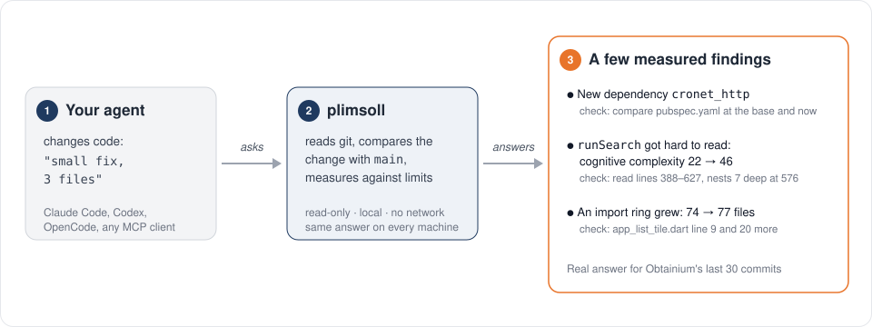

<p align="center">
  
</p>

<h1 align="center">plimsoll</h1>

<p align="center"><strong>Catch what your coding agent's changes do to your code: new dependencies, tangled imports, functions grown too complex.</strong></p>

<p align="center">
  <a href="https://github.com/julianzh0/plimsoll/releases/latest"></a>
  <a href="https://github.com/julianzh0/plimsoll/actions/workflows/ci.yml"></a>
  <a href="go.mod"></a>
  <a href="https://modelcontextprotocol.io"></a>
  <a href="LICENSE"></a>
  <a href="https://glama.ai/mcp/servers/julianzh0/plimsoll"></a>
</p>

<p align="center"></p>

After a change, your agent asks plimsoll and gets back the areas the change made worse, the files outside it that use
what it altered, and a few findings, each measured, each with its limit and a way to check it. Here is a real answer for the last 30 commits of [Obtainium](https://github.com/ImranR98/Obtainium):

```text
plimsoll 0.10.0 status: base `HEAD~30` e9087ce099, head 35c3e7fea4
Areas: 3 worse (dependencies 1, wiring 1, functions 2); not analysed: settings
Blast radius: 50 files outside the change use or import what it altered or removed (25 product, 25 test)
3 new, 1 grown, 0 resolved; 14 more in `report` only

1. [new, exact] `pubspec.yaml` names 1 runtime dependency that was not there at the base: `cronet_http` (47 now, 46 at the base).
2. [new, candidate] `lib/pages/add_app.dart` `runSearch` crossed the limit of 25 in this change: cognitive complexity 22 → 46 (+24).
   verify: read lines 388–627 (172 of them added by this change): it nests 7 levels deep at line 576; …
3. [grown, candidate] The ring of `lib/app_sources/apk4free.dart` has 77 files, 74 at the base.
   verify: grown through `lib/components/app_list_tile.dart` line 9 importing `lib/app_sources/github.dart` and 20 more, added by this change; …
…
```

## Let your agent set it up

Paste this into your coding agent (Claude Code, Codex, OpenCode, Cursor or any other with a shell). It installs
plimsoll, connects it, reads your repository and proposes a `.plimsoll.toml`, writing nothing without your yes:

```text
Fetch https://raw.githubusercontent.com/julianzh0/plimsoll/main/docs/agent-setup.md with `curl -fsSL` and follow it.
```

In Windows PowerShell the command is `curl.exe -fsSL`; an agent without a shell needs
[the setup page](docs/agent-setup.md) pasted in. Then ask it, for example: *"Use plimsoll to check what this branch
did to the repository since `main`."* To install and connect by hand instead, see [Install](#install).

## What it catches

- **Which areas got worse:** one line per answer counts the areas the change made worse or better (size,
  dependencies, wiring, functions, process), each backed by the marks it names. No score is invented.
- **Blast radius:** how many files outside the change use or import what it altered or removed, product files first.
- **New dependencies** a change slipped in, and whether a lockfile holds them.
- **Functions the change made hard to read:** deep nesting or pasted blocks, in 12 languages.
- **Size:** code files past their line limit, test code growing past twice the product code, and the test lines of
  each kind of test your repository declares.
- **Wiring:** an import ring the change closed or grew, folders depending on each other in a circle, product code
  importing test code, and imports that break the rules your repository declares.
- **Hidden coupling:** files that keep changing together in the same commits.
- **Process leftovers:** a plan or review file committed, a setting defined twice or never read, and added code that
  nothing uses.

## Your own rules

An optional `.plimsoll.toml` at the repository's root, committed and reviewed like any other file, sets your own
limits, tells plimsoll how your repository is laid out, and declares your architecture. Every key is optional:

```toml
[limits]
file_lines = 1500                           # a code file's line limit (default 1,000)
test_ratio = 3.0                            # test lines per product line (default 2.0)
shared_commits = 8                          # commits two files share before they are a pair (default 5)
hotspot_files = 5                           # files the report lists as hotspots (default 3)

[layout]
test_folders = ["checks", "tools/harness"]  # folders whose code is test code
test_files = ["*_spec.rb", "*IT.java"]      # names of test files
planning_folders = ["backlog"]              # folders of planning or review notes
planning_files = ["*.plan.md"]              # names of planning or review notes

[ignore]
folders = ["src/test/resources/fixtures"]   # folders whose files plimsoll leaves out
files = ["SPEC.md", "*.generated.go"]       # names of files plimsoll leaves out

[defaults]
base = "main"                               # the base of a question that names none

[imports]
never = ["src/domain -> src/adapters"]      # code under the first folder imports none under the second
only = ["src/domain -> src/shared"]         # code under the first folder imports only there and in itself

[acknowledged]                              # standing items reviewed and kept on purpose, each with a reason
"process.planning-file:SPEC.md" = "a lasting specification, not a plan"

[tests]                                     # your kinds of tests, by your own names; the first that matches wins
integration = ["**/*_integration_test.go", "tests/integration/**"]
e2e = ["e2e/**"]
unit = ["**/*_test.go", "tests/**"]
```

| Key | What it declares |
|---|---|
| `file_lines`, `test_ratio`, `shared_commits` | The limits of the file-size, test-ratio and co-change rules |
| `hotspot_files` | How many files the report lists as hotspots |
| `test_folders` | Folders, as paths from the root, whose code files count as test code, beside the defaults |
| `test_files` | File names of code files that count as test code wherever they lie: `*` is any run of characters, `?` one |
| `planning_folders` | Folders, as paths from the root, whose files are planning or review records, beside the default paths |
| `planning_files` | File names, with the same patterns as `test_files` but without regard to case, of planning or review records wherever they lie |
| `folders` under `[ignore]` | Folders, as paths from the root, whose files plimsoll leaves out: no code, no planning record, no documentation it reads |
| `files` under `[ignore]` | File names, with the same patterns as `test_files`, of files plimsoll leaves out wherever they lie |
| an entry of `[acknowledged]` | A mark identifier exactly as an answer printed it, and a reason: a standing item with that identifier is listed under "Acknowledged" in `report` instead of "Standing", and `status` counts such items in one line. The item is still measured and counted; when it grows, or a new item gets its identifier, it shows as usual. Function marks never stand, so they are not acknowledged. The reason is required and never printed |
| `never`, `only` under `[imports]` | Import rules, each `"<folder> -> <folder>"` (below) |
| an entry of `[tests]` | A kind of test code by the repository's own name (letters, digits, `_`, `-`) and its path patterns from the root: `*` and `?` within one folder level, `**` for any depth (`e2e/**`, `**/*IT.java`). A test-code file belongs to the first kind listed that matches it; `report` counts each kind's test lines and the rest. A kind never makes a file test code: declare that in `[layout]` |
| `base` | The branch, remote branch or tag a question without a base compares with. A remote branch is named with its remote (`origin/main`): `main` alone finds no remote branch. A branch of the name comes before a remote branch, and a remote branch before a tag |

A declaration adds to the defaults and takes none away. The file switches no rule off: an acknowledged item is still
measured and counted, only listed apart, and `[ignore]` is the one way to leave files out. Every mark names its
limit's source, for example "1,500 lines, set by `.plimsoll.toml`", and a limit or declaration changed since the base
is itself a mark, so raising a limit to silence a finding shows in the answer.

**Import rules** turn your architecture into marks. Each is one text `"<folder> -> <folder>"`, two folders from the
root:

- `never = ["a -> b"]`: product code under `a` imports no code under `b`.
- `only = ["a -> b", "a -> c"]`: product code under `a` imports code only under `a` itself and the folders named; a
  folder created later is outside until an entry names it.

A change that writes an import breaking a rule gets a mark naming up to two such imports by file and line; a break
already at the base is standing. A broken rule is information, never a gate or an exit code. What a rule cannot see
in each language, and how invalid values are handled: [rules](docs/rules.md#your-own-limits-and-layout).

## Why you can trust it

Every finding is measured, names its limit and where that limit comes from, and says how to check it yourself. plimsoll
only reads: no network, no telemetry, nothing written into your repository, nothing stored. Each mark was read blind
on real agent pull requests before it was allowed into the short answer, and marks that failed that test show only
in the full report. MIT licensed. It works next to your linters and CI, not instead of them. [Guarantees and their tests](docs/guarantees.md).

## Speed

The first question on a repository takes a few seconds; every later one, also after an edit, is much faster
(about a third of a second on a few thousand files), because plimsoll keeps what it has read in memory while it runs. Measured with plimsoll 0.10.0 on an
Apple M6 (12 cores, 32 GB) against the last 30 commits, while other work was running (load average 7 to 12):

| Repository | Files | First question | Later questions | Peak memory |
|---|--:|--:|--:|--:|
| [Obtainium](https://github.com/ImranR98/Obtainium) | 320 | 3.0 s | 0.21 s | 0.2 GB |
| [LocalSend](https://github.com/localsend/localsend) | 1,037 | 3.0 s | 0.25 s | 0.3 GB |
| [nlohmann/json](https://github.com/nlohmann/json) | 1,674 | 12 s | 0.31 s | 0.7 GB |
| [swc](https://github.com/swc-project/swc) | 83,143 | 54 s | 7.7 s | 2.5 GB |

## Install

macOS and Linux, amd64 and arm64:

```sh
curl -fsSL https://raw.githubusercontent.com/julianzh0/plimsoll/main/install.sh | sh
```

The script downloads the binary of the latest [release](https://github.com/julianzh0/plimsoll/releases), checks its
SHA-256 checksum and puts it in `~/.local/bin` (`PLIMSOLL_INSTALL_DIR` changes the folder, `PLIMSOLL_VERSION` picks
a release). You can also download a binary and `checksums.txt` from the release page yourself, or build from source
with Go (see [Development](docs/development.md)).

Windows, amd64 and arm64, in PowerShell:

```powershell
irm https://raw.githubusercontent.com/julianzh0/plimsoll/main/install.ps1 | iex
```

The script does the same and puts `plimsoll.exe` in `%LOCALAPPDATA%\plimsoll`, which it adds to your user PATH
(`$env:PLIMSOLL_INSTALL_DIR` and `$env:PLIMSOLL_VERSION` work as above). The Windows build is checked by compiling it,
not by a Windows test run.

plimsoll is listed in the [official MCP registry](https://registry.modelcontextprotocol.io) as
`io.github.julianzh0/plimsoll`: clients that install from there get an MCP bundle with the binaries above.

### Connect your agent

plimsoll is a local MCP server on standard input and output. It reads no setting; `plimsoll --version` and
`plimsoll --help` only print and exit.

**Claude Code**

```sh
claude mcp add plimsoll -- plimsoll
```

**Codex** (the CLI, the IDE extension and the ChatGPT desktop app share this setting)

```sh
codex mcp add plimsoll -- plimsoll
```

or in `~/.codex/config.toml`:

```toml
[mcp_servers.plimsoll]
command = "plimsoll"
```

**OpenCode**

```sh
opencode mcp add --global plimsoll -- plimsoll
```

**Any other MCP client** (Claude Desktop, Cursor, Antigravity and others), in its server configuration:

```json
{
  "mcpServers": {
    "plimsoll": { "command": "plimsoll" }
  }
}
```

Or let your agent do all of this: see [Let your agent set it up](#let-your-agent-set-it-up).

## Tools

| Tool | Returns |
|---|---|
| `status(repository, base?)` | the areas the change made worse, better or could not analyse and its blast radius, at most five new or grown marks, one line that counts the marks shown in `report` only, one that counts what the change touched but did not create, one that counts added code without a use, the standing line, one that counts the standing items the repository acknowledges, the footprint and what was not analysed |
| `report(repository, base?, files?)` | the same areas and blast radius, then everything measured, in a fixed layout, the touched items included. Standing items of one kind past five are counted by folder in the text, and `structuredContent` holds them all. With `files`, also the files that import each named file |
| `explain(repository, base?, mark)` | the evidence of one mark, computed again and capped |

Without `base`, a question compares with the default base the repository declares in `.plimsoll.toml`, and the
answer's first line says so. Every result carries the text in `content` and the same answer as `structuredContent`. An answer may shorten, never
hide: what it leaves out it counts ("3 more: `report` lists them"), and `report` holds every mark.

## Learn more

- [What plimsoll checks](docs/rules.md): every rule, what it measures and its limit, and exactly how
  `.plimsoll.toml` is read.
- [How each language is read](docs/languages.md): the twelve languages, how their imports and test code are found.
- [Guarantees and protocol](docs/guarantees.md): what plimsoll promises, with the tests that pin each promise.
- [Setting up with your agent](docs/agent-setup.md): the page your agent follows to install, connect and
  configure plimsoll.
- [Development](docs/development.md): building, testing and the project's structure.

## License

[MIT](LICENSE)
